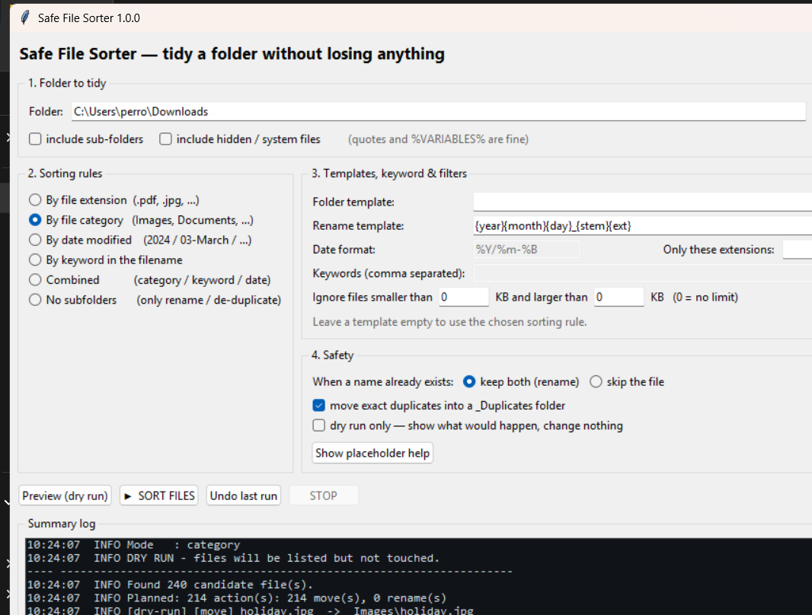

# Safe File Sorter

A standalone desktop utility (Python 3.10+ / Tkinter, standard library only) that
tidies a messy folder: it groups files by extension, category, date or filename
keyword, optionally batch-renames them, and prints a full summary log — without
ever deleting anything, and with a one-click **Undo** for the whole run.



```
+--------------------------------------------------------------------------+
| Safe File Sorter — tidy a folder without losing anything                  |
+--------------------------------------------------------------------------+
| 1. Folder to tidy  [ C:\Users\me\Downloads        ] [Browse…] [Open]      |
|    [ ] include sub-folders   [ ] include hidden / system files            |
+---------------------------+----------------------------------------------+
| 2. Sorting rules          | 3. Templates, keyword & filters              |
|  (•) By file extension    | folder template [ {category}/{year}        ] |
|  ( ) By file category     | rename template [ photo_{year}{month}...   ] |
|  ( ) By date modified     | date format     [ %Y/%m-%B     ]             |
|  ( ) By keyword           | keywords        [ invoice, receipt         ] |
|  ( ) Combined             | only extensions [ pdf, jpg                 ] |
|  ( ) No subfolders        | size between    [ 0 ] and [ 0 ] KB           |
|                           | -------------------------------- 4. Safety --|
|                           | conflicting name: (•) keep both ( ) skip     |
|                           | [ ] move exact duplicates to _Duplicates     |
|                           | [ ] dry run only (change nothing)            |
+---------------------------+----------------------------------------------+
| [Preview (dry run)] [▶ SORT FILES] [Undo last run] [STOP] [Save log…]    |
+--------------------------------------------------------------------------+
| Summary log (colour-coded, scrollable, savable)                          |
| 18:15:49  INFO [move] holiday.jpg  ->  JPG\holiday.jpg                   |
| 18:15:49  WARN notes.txt: destination exists — using notes (2).txt       |
| 18:15:49  ERR  locked.db: move failed (in use by another program)        |
| 18:15:49  OK   Finished: 12 moved, 0 renamed | undo file: journal-…jsonl |
+--------------------------------------------------------------------------+
| Done: 12 moved, 0 renamed                        [##########----]         |
+--------------------------------------------------------------------------+
```

---

## 1. Quick start

```bat
cd file-sorter
python run.py                 :: start the GUI
python run.py "D:\Downloads"  :: start the GUI with a folder already selected
```

Click **Preview (dry run)** first: it lists every planned action and changes
nothing. When the preview looks right, press **▶ SORT FILES**.

No third-party packages are needed — Tkinter ships with the python.org
installers for Windows and macOS. On Debian/Ubuntu: `sudo apt install python3-tk`.

## 2. What the sorting rules do

| Rule | Result |
|---|---|
| **By file extension** | `JPG\holiday.jpg`, `PDF\report.pdf`, `_NoExtension\LICENSE` |
| **By file category** | `Images\`, `Documents\`, `Spreadsheets\`, `Video\`, `Audio\`, `Archives\`, `Code\`, `Installers\`, `Fonts\`, `Other\` |
| **By date modified** | `2024\03-March\report.pdf` (pattern configurable) |
| **By keyword** | first keyword in your list found in the filename; everything else goes to `_Unsorted\` |
| **Combined** | `Documents\invoice\2024\03-March\` |
| **No subfolders** | nothing is moved; only batch-rename and de-duplication apply |

**Templates** override the rule above. Both templates accept placeholders:

| Placeholder | Meaning |
|---|---|
| `{ext}` / `{EXT}` | original extension including the dot: `.pdf` / `.PDF` |
| `{category}` | `Images`, `Documents`, … |
| `{keyword}` | the keyword that matched (`_Unsorted` when none did) |
| `{year} {month} {monthname} {day} {weekday} {hour} {minute} {second}` | parts of the modification date |
| `{date}` | the date format field, e.g. `%Y/%m-%B` |
| `{name}` / `{stem}` | original filename with / without extension |

Examples:

* folder template `{category}/{year}` → `Images\2024\holiday.jpg`
* rename template `IMG_{year}{month}{day}_{stem}{ext}` → `IMG_20240315_holiday.jpg`
* rename template `{year}-{month}-{day}-{stem}` → the original extension is
  appended automatically, so you do not have to write `{ext}`.

Filters: only-listed-extensions, minimum/maximum size in KB, "include
sub-folders", "include hidden / system files".

## 3. Safety model

* **Nothing is ever deleted.** No delete or overwrite operation exists in the code.
* **Names are never silently replaced.** When a destination name is taken the file
  is renamed (`report (2).pdf`) or skipped, depending on the *Safety* choice.
  This also covers files that are already sorted and stay in place.
* **Dry run** computes the complete plan and touches no file.
* **Undo journal.** Every run appends to
  `<folder>\.filesorter\logs\journal-<timestamp>.jsonl` *as it goes*, so a crash
  or a Stop still leaves a usable undo record. **Undo last run** replays it
  backwards; a name that reappeared meanwhile is restored with a new suffix
  instead of being overwritten. A consumed journal is renamed `….undone-<timestamp>`.
  A torn or corrupt line in a journal is skipped instead of aborting the undo.
  If the journal cannot be written at all, the run still completes but says so
  clearly ("no undo file"), because the moves themselves are collision-safe.
* **Containment.** Every destination is computed relative to the chosen folder and
  verified with a path check; `..`, absolute paths pasted into a template, and
  over-long Windows paths are refused and reported.
* **Windows-safe names.** `<>:"/\|?*`, control characters, reserved device names
  (`CON`, `NUL`, `COM1`…), trailing dots/spaces and 255-character limits are handled.
* **Symlinks and NTFS junctions are never followed.** A junction inside the
  chosen folder is skipped when scanning, and a destination that resolves
  through one is refused, so a file can never be moved outside the folder you
  picked. The tool's own `.filesorter` folder is never sorted. Cross-volume
  moves fall back to copy → verify size → delete the original.
* **Failures are reported, not fatal.** A locked, vanished or unreadable file is
  logged and the run continues; a file that disappears between planning and
  execution is skipped rather than crashing the batch.
* **Dry runs create nothing at all** - not even the bookkeeping folder.

Duplicate detection (optional) compares size first and then a BLAKE2b hash, so only
byte-identical files are treated as duplicates; the copies are moved to
`.filesorter\_Duplicates`. The first file in scan order stays where it belongs.

## 4. Command line (scripting, scheduled tasks)

```bat
python run.py --cli --folder "D:\Downloads" --group extension --dry-run
python run.py --cli --folder "D:\Downloads" --group date --date-format "%Y/%m"
python run.py --cli --folder "D:\Downloads" --group keyword --keywords invoice,receipt
python run.py --cli --folder "D:\Downloads" --rename "IMG_{year}{month}{day}_{stem}{ext}"
python run.py --cli --folder "D:\Downloads" --folder-template "{category}/{year}" --dedupe
python run.py --cli --folder "D:\Downloads" --list-journals
python run.py --cli --folder "D:\Downloads" --undo --last
python run.py --cli --folder "D:\Downloads" --undo --journal ".filesorter\logs\journal-…jsonl"
```

`--recurse`, `--hidden`, `--extensions pdf,jpg`, `--min-kb`, `--max-kb`,
`--conflict rename|skip`, `--quiet`, `--no-logfile` are also available;
`python run.py --cli --help` lists everything.
Exit codes: `0` success or dry run, `1` nothing to do / error, `2` bad arguments.

## 5. Project layout

```
file-sorter/
├── run.py                     launcher: GUI by default, --cli for head-less use
├── run_gui.bat                double-clickable Windows launcher
├── filesorter/
│   ├── core.py                engine: scan → plan → execute → journal → undo
│   ├── gui.py                 Tkinter interface (worker thread + message queue)
│   ├── cli.py                 argparse front-end
│   └── __init__.py            public API re-exports
├── tests/
│   ├── test_core.py           59 unit tests, no pytest required
│   ├── gui_workflow.py        end-to-end: drives the real buttons, worker and undo
│   ├── gui_smoke.py           builds the real window, exercises it, screenshots it
│   └── gui_screenshot.py      launches the app as a user would and captures the screen
└── README.md
```

`core.py` never imports Tkinter, so the engine can be scripted or tested head-less.

## 6. Tests

```bat
python tests\test_core.py          :: 59 unit tests, standalone runner
python tests\gui_workflow.py       :: 21 end-to-end checks through the real GUI
python tests\gui_smoke.py out.png  :: build the window and screenshot it
```

The unit suite covers scanning (including symlink and sub-folder pruning), all six
grouping modes, template rendering, filters, collisions, duplicate detection,
path-escape refusal, reserved Windows names, real moves, the "already sorted
folder is a no-op" guarantee, and undo (including the "do not overwrite what
reappeared" rule). `gui_workflow.py` drives the actual buttons and worker thread –
preview, sort, a second no-op run, undo and invalid input – with only the modal
dialogs stubbed out. Tests create their own scratch folders and clean up.

## 7. Building the Windows .exe release

```bat
python build_exe.py --install-tools    :: once: create .build-venv + install PyInstaller
python build_exe.py                    :: build dist\SafeFileSorter.exe
python build_exe.py --clean            :: rebuild from scratch
python build_exe.py --onedir           :: folder build instead of one file
python build_exe.py --no-cli           :: GUI executable only
```

The result lands in `dist\`:

| File | Purpose |
|---|---|
| `SafeFileSorter.exe` | the GUI release file — double-click it, no Python needed (10.3 MB) |
| `SafeFileSorter-CLI.exe` | same engine with a console, for scripts and scheduled tasks |

Both executables are verified by `python tests\exe_smoke.py` (19 checks: dry run,
sort, undo, exit codes, Unicode names, dedupe, GUI start-up). See
[RELEASE.md](RELEASE.md) for the notes that ship with the build.

Both are self-contained one-file builds: the standard library, Tcl/Tk and the
application are inside the `.exe`. `SafeFileSorter-CLI.exe --cli --help` prints
the command-line reference; `SafeFileSorter.exe --help` prints a short window
that lists the options.

Notes:

* The build needs no manual steps — `build_exe.py` generates the icon
  (`packaging/app.ico`) and the Windows version resource
  (`packaging/version_info.txt`) from `filesorter/version.py`, so bumping the
  version there versions the whole release.
* PyInstaller lives in a project-local `.build-venv` when you create one with
  `--install-tools`; otherwise the build uses whatever interpreter runs
  `build_exe.py` (PyInstaller must be importable there). Your system Python is
  never modified by the build itself.
* `--onedir` produces a folder that starts faster and is easier to code-sign;
  one-file is the more convenient single artefact to hand to somebody.
* The executables are unsigned, so Windows SmartScreen may show a "unknown
  publisher" prompt on first run. Signing requires a code-signing certificate;
  `signtool sign /fd SHA256 /a dist\SafeFileSorter.exe` is the usual command.
* Licensing: the application code is MIT (`LICENSE`); the bundled Python,
  Tcl/Tk and PyInstaller terms are listed in `THIRD-PARTY-NOTICES.txt` — keep
  that file alongside the executables when you pass them on.

## 8. Where your settings live

The GUI remembers your last choices in a per-user settings file:

| Platform | Location |
|---|---|
| Windows | `%APPDATA%\SafeFileSorter\filesorter-gui-settings.json` |
| macOS | `~/Library/Application Support/SafeFileSorter/…` |
| Linux | `$XDG_CONFIG_HOME` (or `~/.config`)/`SafeFileSorter/…` |

Set the `FILESORTER_SETTINGS` environment variable to keep that file elsewhere
(the test scripts use this so they never touch your real profile).

## 9. Where to extend

* new file categories → `CATEGORY_MAP` in `filesorter/core.py`
* new placeholders → `TEMPLATE_TOKENS` and `_resolve_tokens()`
* new sorting rules → add a constant + `GROUPING_LABELS` entry and a branch in
  `_folder_parts()`
* new actions (e.g. "move files older than N days to an archive") → add a field to
  `SortConfig`, a branch in `plan_actions()`, and (if it is not a move) a new
  record type in `JournalWriter`/`undo_journal()`.

## 10. Known limits

* Single-threaded engine: one sort runs at a time (the GUI disables the buttons
  and offers STOP).
* Undo is one-way: there is no "redo".
* The `_Duplicates` folder lives inside `.filesorter`; move those files out before
  deleting that folder.
* Journals and run logs accumulate in `.filesorter\logs` — delete old ones
  yourself when you no longer need the undo history.
* Sorting a folder that another program is writing to can produce "vanished
  before it could be moved" entries in the log; those files are simply skipped.
* Duplicate detection hashes each candidate file (that is what makes it exact);
  on a folder with very many files, expect `dedupe` to take noticeably longer
  than a plain sort. Content hashes are cached per path for the duration of a
  run, so a file rewritten *by another program* mid-run could in theory be
  misjudged as a duplicate - do not edit files while a sort is running.
