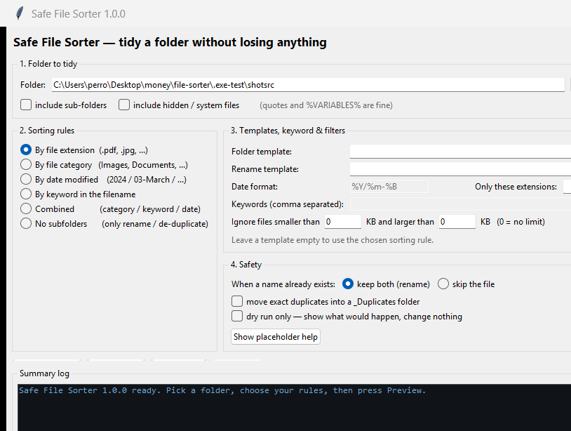

# Release 1.0.0 — Windows executables

Built from this source tree with PyInstaller 6.22.3 on Windows (Python 3.12.10,
64-bit). Both executables are self-contained: **no Python installation is
required** on the machine that runs them.



## Files

| File | Size | Purpose |
|---|---|---|
| `dist/SafeFileSorter.exe` | 10.3 MB | **the release file** — GUI build, no console window |
| `dist/SafeFileSorter-CLI.exe` | 10.4 MB | identical engine with a console, for scripting and scheduled tasks |

Both are one-file builds: the standard library, Tcl/Tk, the ttk themes and the
application are packed inside the `.exe`, which unpacks to a temporary folder at
startup and cleans up on exit. The icon and Windows version resource are
embedded (Details tab: *Safe File Sorter 1.0.0*).

## Usage

```
SafeFileSorter.exe                      start the GUI
SafeFileSorter.exe "D:\Downloads"       start with a folder pre-selected
SafeFileSorter.exe --help               short help window

SafeFileSorter-CLI.exe --cli --help     full command-line reference
SafeFileSorter-CLI.exe --cli --folder "D:\Downloads" --group category --dry-run
SafeFileSorter-CLI.exe --cli --folder "D:\Downloads" --dedupe
SafeFileSorter-CLI.exe --cli --folder "D:\Downloads" --undo --last
```

Exit codes (CLI): `0` success or dry run, `1` nothing to do / error, `2` bad
arguments. Nothing is ever deleted; every real run writes an undo journal to
`<folder>\.filesorter\logs\`.

## Verification

`python tests\exe_smoke.py` drives the built binaries the way a user would —
**19/19 checks pass** on this build:

* both executables exist, are ~10.3 MB, and carry the icon + version resource;
* `SafeFileSorter-CLI.exe --cli --help` exits 0, documents `--undo`;
* dry run exits 0, moves nothing and creates nothing (not even `.filesorter`);
* a real sort groups files into `Documents/`, `Images/`, `Spreadsheets/` and
  writes exactly one undo journal;
* `--undo --last` restores the original layout exactly;
* missing folder → exit 1, no `--folder` → exit 2;
* Unicode names (`café.txt`, `emoji 😀.txt`) sort correctly;
* `--dedupe` keeps one copy and archives the byte-identical twin;
* `SafeFileSorter.exe` starts as a real window, renders the full interface and
  shuts down cleanly.

The engine itself is covered by `python tests\test_core.py` (59 tests) and
`python tests\gui_workflow.py` (21 end-to-end GUI checks), which run against the
source tree.

## Rebuilding

```bat
python build_exe.py --install-tools    :: once, installs PyInstaller locally
python build_exe.py                    :: rebuild dist\*.exe
python build_exe.py --onedir           :: folder build instead of one file
```

The build regenerates `packaging/version_info.txt` and `packaging/app.ico` from
`filesorter/version.py`, so bump the version there for the next release.

## Notes and caveats

* **Unsigned.** Windows SmartScreen may show an "unknown publisher" prompt the
  first time the `.exe` is run. Click *More info → Run anyway*, or sign it:
  `signtool sign /fd SHA256 /a dist\SafeFileSorter.exe`.
* **`%TEMP%` must be writable.** A one-file build unpacks itself there at
  startup. This is normal on a user machine; built inside a locked-down sandbox
  the bootloader reports `Could not create temporary directory!` — use the
  `--onedir` layout there instead.
* Antivirus scanners occasionally flag freshly built, unsigned one-file
  bootloaders. The `--onedir` layout avoids that.
* Licensing: application code is MIT (`LICENSE`); the bundled Python, Tcl/Tk and
  PyInstaller terms are listed in `THIRD-PARTY-NOTICES.txt`. Keep that file with
  the executables when redistributing.
